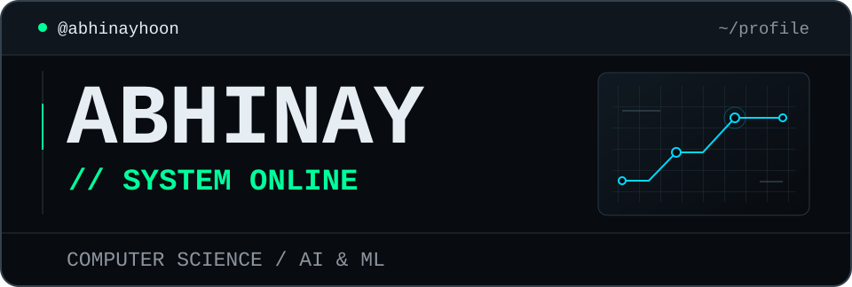

# Abhinay Pratap Singh

I’m a B.Tech Computer Science and Engineering student specializing in AI and Machine Learning. I build Python tools that make unexpected data easier to inspect, and web projects that make technical ideas easier to explore.

**Current focus** · Data structures, machine learning fundamentals, and small automation tools with tests and clear documentation.

## Selected work

### [SignalCheck](https://github.com/abhinayhoon/signalcheck)
A Python CLI for checking data before model inference. It compares a candidate CSV with a reference CSV to flag schema changes, spikes in missing values, new categories, and shifts in numerical inputs. JSON output makes the results usable in scripts and CI.

`Python` · `pytest` · `JSON CLI output`

### [DisplaceOS](https://github.com/abhinayhoon/DisplaceOS-GheeKhatam)
A role-based disaster-relief coordination prototype. Camp managers report needs, coordinators allocate stock, and field teams update deliveries. A local action queue lets field users sync queued updates after reconnecting.

`TypeScript` · `Next.js` · `PostgreSQL` · `Prisma`

### [Python Roadmap](https://github.com/abhinayhoon/PythonRoadmap)
A self-paced Python curriculum with 30 lessons, searchable examples, and exercises. The static site keeps progress in the browser so beginners can pick up where they left off without creating an account.

`HTML` · `CSS` · `JavaScript` · [Live site](https://abhinayhoon.github.io/PythonRoadmap/)

## Toolkit

- **Data and tooling** · Python, CSV, JSON, pytest
- **Web and application development** · HTML, CSS, JavaScript, TypeScript, Next.js, PostgreSQL
- **Engineering workflow** · Git, GitHub, GitHub Actions

## Activity

[GitHub contribution calendar](https://github.com/abhinayhoon#js-contribution-activity) · [Engineering log](ACTIVITY_SYSTEM.md) · [Public repositories](https://github.com/abhinayhoon?tab=repositories)

I’m interested in contributing tests, documentation, and issue triage to Python tools and AI/ML learning projects. I aim to leave each project with a clear way to reproduce the result and enough context for the next contributor to pick it up.

## Connect

[Portfolio](https://abhinayhai.vercel.app/) · [LinkedIn](https://www.linkedin.com/in/abhinayhai/) · [Email](mailto:maiabhinayhoon@gmail.com)
